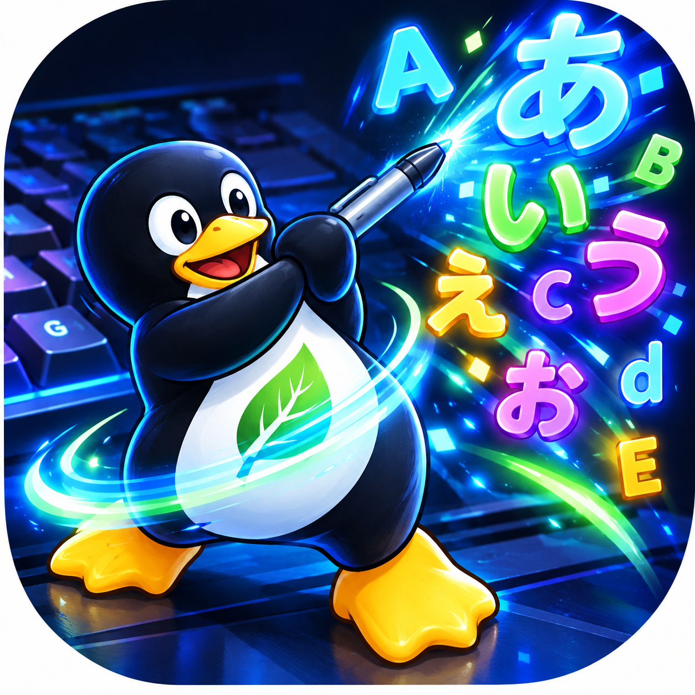

# 🐧 FlickTux (`flktux`)

<p align="center">
  
  <br>
  <em>ペンタブ＆10キー対応 Linuxフローティング・フリックキーボード</em>
</p>

[](LICENSE)
[-orange.svg)]()
[]()
[]()

---

## 🌟 FlickTux とは？

**FlickTux (`flktux`)** は、ペンタブレット（Wacom Bamboo / Intuos 等）や外付けテンキーを活用し、**イラスト制作・デザイン・日常作業における文字入力を劇的に高速化・快適化**するために開発されたオープンソースの入力支援ツールです。

スマートフォンでおなじみの**フリック入力**（Google / Galaxy / iPhone / ガラケー配列）に加え、イラストレーターに大人気の「左手デバイス（10キー）」に対応した**独自の縦5×横4テンキー配列**を標準搭載しています。

さらに、ペンの筆圧カーブ、手ブレ補正（追従性）、16:9正円比率維持、手のひら誤爆防止（指タッチOFF）をワンクリックで調整できる**「ペンタブ感度設定センター（リアルタイム試し書き広場つき）」**が統合されています。

---

## 🚀 主な機能

### 1. 📱 5大レイアウト ＆ 4大入力モード（かな / カナ / 英字 / 数字）
FlickTux はすべてのレイアウトで **「かな」「カナ」「英字 (Alphabet)」「数字 (123)」** の4モードをシームレスに切り替えられます。`[あ/A/1]` モードボタンをタップするだけで瞬時に全キーが切り替わります。

- **Google (Gboard風)**: 記号・変換・確定が配置された親しみやすい標準配列。
- **Galaxy (Samsung風)**: 数字キーや方向キーがアクセスしやすい配列。
- **iPhone (iOS風)**: 日本のiPhoneユーザーが迷わず打てる配列。
- **ガラケー (ケータイ打ち)**: テンポの良い連打（あ→い→う→え→お / a→b→c）と専用の「次へ」ボタン。
- **10キー (縦5×横4 テンキー配列)**: 
  - **かなモード**:
    - **7: あ行**, **8: か行**, **9: さ行**
    - **4: た行**, **5: な行**, **6: は行**
    - **1: ま行**, **2: や行**, **3: ら行**
    - **0: わ行**, **.: 、。**, **\*: ゛゜小**, **+: 次へ**, **Enter: 確定**
  - **カタカナモード**:
    - **7: ア行**, **8: カ行**, **9: サ行**, **4: タ行**...（濁点・小文字もカタカナに完全連動）
  - **英字・アルファベット (ABC) モード**:
    - **7: abc**, **8: def**, **9: ghi**
    - **4: jkl**, **5: mno**, **6: pqrs**
    - **1: tuv**, **2: wxyz**, **3: @._/**
    - **0: ␣ (空白)**, **.: .,?!**, **\*: a/A (大文字/小文字切替)**
    - ペン先での英字フリックも、連打トグル（a→b→c）も、PC/外付けテンキーの打鍵も完全対応！
  - **数字モード**:
    - 7, 8, 9 / 4, 5, 6 / 1, 2, 3 / 0 の直感的なテンキー入力。


### 2. 🪟 完全フローティング ＆ 位置の自動記憶
- お絵描きキャンバスやブラウザ入力欄の邪魔にならない位置へ、ヘッダーをドラッグして自由に移動可能。
- 最後に置いた画面座標 $(x, y)$ を自動保存し、次回起動時もその位置にピタッと浮遊表示。
- 対象アプリのフォーカスを絶対に奪わない（`set_accept_focus(False)`）ため、テキストカーソルを維持したまま文字を流し込めます。

### 3. ⚡ 超高速常駐パイプ (`XdoPipe`) ＆ 小文字バグの完全根絶
- 1文字入力ごとのプロセス起動遅延（数十ms）を排除する常駐パイプラインを採用。
- `BackSpace` ➔ `50ms待機` ➔ `新文字` を不可分（atomic）に送るため、Mozc / X11 で小文字・濁点（`゛゜小`）を押した際に文字が消える不具合を完全に解消。

### 4. 🎨 ペンタブ感度・お絵描き調整センター (`flktux-settings`)
- **ワンクリック・プロファイル:**
  - 🎨 **イラスト・お絵描き**: 筆圧柔らかめ（強弱が綺麗に出る）、手ブレ補正ON、16:9正円比率維持（真円が楕円に歪まない）、手のひら誤爆防止（指タッチOFF）
  - ⚡ **超機敏・快速**: 遅延ゼロ（RawSample 1）、羽のように軽いクリック（Threshold 8）、指トラックパッド高速モード（1.8x）
  - ⚖️ **標準・バランス**: Wacom標準のバランス設定
- **🖊️ リアルタイム筆圧・試し書きテスト広場:**
  - 設定画面内のキャンバスにペンで線を描くと、**ペンの筆圧に応じてリアルタイムに線の太さが変化**。描き味をその場で即座に体感確認できます。

### 5. 🖐️ 外付けテンキー「左手デバイス」連動
- 左手で外付けBluetooth/USBテンキーを持ち、右手でペンを走らせるイラストレーター向けワークフローに対応。
- 物理キー `7, 8, 9, 4, 5, 6, 1, 2, 3, 0` を押すだけで、ガラケー打ちトグル入力が発火します。

---

## 📦 インストール方法

### 必要環境
- OS: Linux (Linux Mint, Ubuntu, Debian 等)
- デスクトップ環境: X11 (Cinnamon, GNOME, XFCE 等)
- 依存パッケージ: Python 3.8+, GTK 3, xdotool, xsetwacom, xinput, python3-xlib

### ワンステップ・インストール
```bash
git clone https://github.com/2theparadise-blip/FlickTux.git
cd FlickTux
sudo bash install.sh
```

---

## 💡 使い方

### コマンドライン
```bash
# FlickTux を起動 / 表示・非表示のトグル
flktux

# トグル専用コマンド (ショートカットキー用)
flktux toggle

# ペンタブ感度・筆圧設定センターを開く
flktux-settings
```

### キーボードショートカット（推奨: F12）
Linux Mint (Cinnamon) の場合:
1. `システム設定` ➔ `キーボード` ➔ `ショートカット` ➔ `カスタムショートカット` を開く
2. 「カスタムショートカットを追加」をクリック
   - 名前: `FlickTux`
   - コマンド: `flktux toggle`
   - キー割り当て: `F12`

---

## 📂 プロジェクト構成

```
FlickTux/
├── bin/
│   ├── flktux               # コマンド実行ファイル (トグル・CLI)
│   └── flktux-settings      # 感度設定センター実行ファイル
├── flktux/
│   ├── __init__.py
│   ├── layouts.py           # 5大レイアウト定義 (Google/Galaxy/iPhone/ガラケー/10キー)
│   ├── numpad_listener.py   # 物理テンキー (Xlib) ハードウェア連動リスナー
│   ├── settings_gui.py      # GTK3 感度設定センター & 試し書きキャンバス
│   ├── ui.py                # フローティングキーボード本体 (GTK3 UI)
│   ├── wacom.py             # xsetwacom / xinput 制御 & プロファイル管理
│   └── xdo.py               # 常駐 xdotool パイプライン (低遅延 & 安全置換)
├── desktop/
│   ├── flktux.desktop
│   └── flktux-settings.desktop
├── install.sh               # 自動インストーラー
├── README.md                # 本ドキュメント
└── SPECIFICATION.md         # 詳細技術仕様書
```

---

## 📜 ライセンス

MIT License
