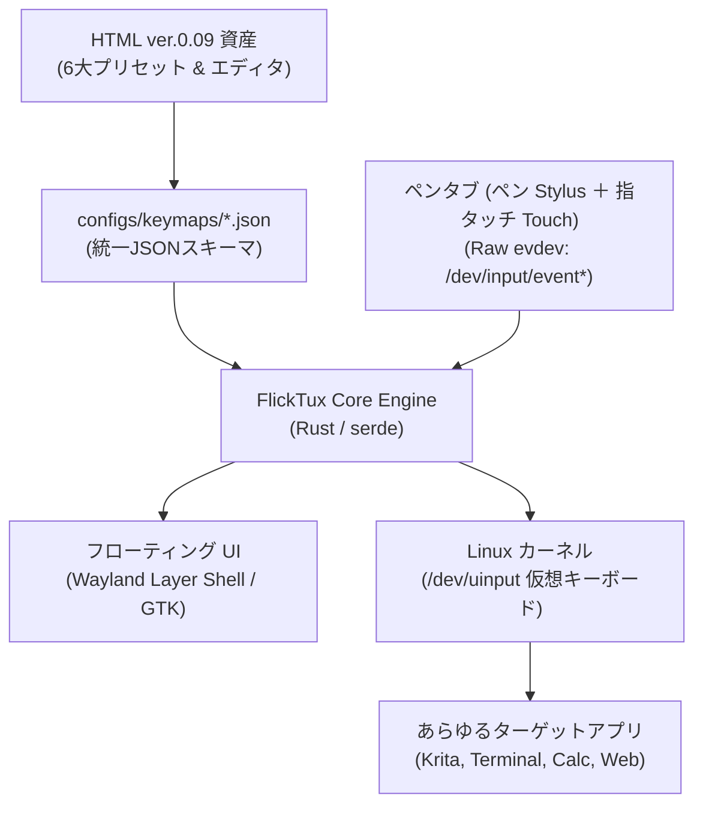

# FlickTux 実装仕様書・開発プラン（Rust 版）

> **文書ステータス**: v3.1（v3.0 を改訂: 特化型入力予測、2本指スワイプ、不可分トグル制御を反映）  
> **名称**: プロジェクト名 **FlickTux**、バイナリ名 **`flktux`** / **`flktux-rs`**（派生名・別エディション名は付けない）  
> **対象システム**: Linux Mint (Cinnamon/X11), Ubuntu を先行。最終的に Raspberry Pi OS (Wayland/X11) のサイバーデッキでも動作させる  
> **開発言語**: Rust (2021 Edition) + Linux Kernel uinput  
> **対象リポジトリ**: `scratch/working/tools/FlickTux/`  

---

## 1. プロジェクト概要とゴール

FlickTux は、**ペンタブレット（ペン先入力 ＋ 指マルチタッチ/トラックパッド）で使うフリックキーボード**です。現行 Python 版（`flktux/`）の機能を Rust で再実装し、軽量・低遅延にします。

> **位置づけ**: 「サイバーデッキ専用版」ではありません。基本設計・機能は共通で、**最終的に Raspberry Pi のサイバーデッキでも使える**ようにする、という配備先のひとつです。
>
> **当面のゴール**: まず **PC + ペンタブ（ペン ＋ 指タッチ）**で、**実用的な速度と感度**で動くこと。Raspberry Pi 対応（クロスビルド・小型タッチ液晶・自動起動）は最終フェーズで行う。

### 達成する主要スペック
1. **ペン ＋ 指タッチ（マルチタッチ）のハイブリッド両対応**:
   * **ペン入力**: Wacom Stylus 等のペン先座標・筆圧による繊細なチョンチョン打ちフリック。
   * **指タッチ入力**: 盤面を指先で滑らせるスマホ同様のダイレクトフリック、トラックパッド操作。
   * **パームリジェクション**: ペン使用時の手のひら誤爆や2本指タップの誤動作を防止。
2. **完全な Wayland / X11 / コンソール両対応**:
   * `xdotool` や X11 API への依存を全廃し、Linuxカーネル標準の **`/dev/uinput` 仮想キーボード** として動作。
   * デスクトップ環境を問わず、ターミナル、エディタ、ブラウザ、全画面Kioskアプリ等、あらゆる画面に直接キーストロークを流し込めます。
3. **極小フットプリント & 超低遅延**:
   * 常駐メモリ: **約 3〜5MB**（Pythonの1/10以下）
   * 入力遅延: **1ms未満**（Down即時判定 & カーネル直接送出）
   * アイドル時CPU: **0.0%**（完全イベント駆動、バッテリーを消費しない）
4. **HTML ver.0.09 資産の完全継承**:
   * 6大プリセット（Google, iPhone 19キー結合, Galaxy, ガラケー, 電卓, 電話）のJSONスキーマ化。
   * HTML版マトリックスエディタを内蔵Webサーバーで提供（スマホやPCからWi-Fi経由で設定変更可能）。

---

## 2. システムアーキテクチャ



```text
+-----------------------------------------------------------------------------------+
|                           ユーザー入力デバイス                                    |
|   [ ペンタブレット (ペン Stylus ＋ 指 Touch) ]   [ 小型タッチパネル (Pi向け) ]    |
+-----------------------------------------------------------------------------------+
                                         |
                                         v
+-----------------------------------------------------------------------------------+
|                     FlickTux コアエンジン (Rust バイナリ)                         |
|                                                                                   |
|  +--------------------+  +----------------------+  +---------------------------+  |
|  | input::evdev       |  | core::flick_engine   |  | core::keymap (serde)      |  |
|  | ペン座標/筆圧      |  | atan2 角度判定       |  | HTML ver.0.09 準拠        |  |
|  | 1000Hz ダイレクト  |  | Down先行/即時判定    |  | 6大プリセット定義         |  |
|  +--------------------+  +----------------------+  +---------------------------+  |
|                                    |                                              |
|                                    v                                              |
|  +-----------------------------------------------------------------------------+  |
|  | uinput::emitter (/dev/uinput 仮想キーボードドライバ)                         |  |
|  | ローマ字バースト送出 / 確定Enter / BackSpaceアトミック置換                    |  |
|  +-----------------------------------------------------------------------------+  |
|                                    |                                              |
|  +---------------------------------+-------------------------------------------+  |
|  | 内蔵 Web マトリックスエディタ (HTML ver.0.09 をローカル配信: ポート8080)     |  |
+-----------------------------------------------------------------------------------+
                                     |
                                     v
+-----------------------------------------------------------------------------------+
|                   Linux カーネル 入力サブシステム (input_event)                   |
|                   Wayland (Labwc/Wayfire) / X11 / コンソール                      |
+-----------------------------------------------------------------------------------+
```

---

## 3. ディレクトリ構成（Rustプロジェクト構造）

```text
tools/FlickTux/
├── Cargo.toml                       # Rustパッケージ構成
├── udev/
│   └── 99-flicktux.rules            # /dev/uinput 権限設定ルール
├── configs/
│   ├── config.json                  # 全体設定（遅延・タイムアウト）
│   └── keymaps/
│       ├── presets/
│       │   ├── google.json          # Google 20キー
│       │   ├── iphone.json          # iPhone 19キー (rowSpan 結合)
│       │   ├── galaxy.json          # Galaxy 20キー
│       │   ├── garakei.json         # ガラケー連打トグル
│       │   ├── tenkey_calc.json     # 10キー (計算機配列 7-8-9)
│       │   └── tenkey_tel.json      # 10キー (電話配列 1-2-3)
│       └── custom/
│           └── user_keymap.json     # エディタで編集したカスタム設定
├── web/                             # HTML ver.0.09 エディタ資産
│   └── index.html                   # 内蔵設定画面 (Tailwind CSS)
└── src/
    ├── main.rs                      # エントリーポイント & CLI
    ├── core/
    │   ├── mod.rs
    │   ├── keymap.rs                # JSONスキーマ定義 (KeyDef, Preset)
    │   └── flick_engine.rs          # ゼロ遅延フリック & トグル状態マシン
    ├── input/
    │   ├── mod.rs
    │   └── evdev_listener.rs        # Raw evdev 入力受領（ペンタブ: 座標/筆圧/接地、後続でタッチパネル）
    ├── uinput/
    │   ├── mod.rs
    │   └── emitter.rs               # /dev/uinput 仮想キーストローク送出
    ├── ui/
    │   ├── mod.rs
    │   └── floating_window.rs       # フローティングキーボード描画
    └── server/
        └── web_editor.rs            # 内蔵エディタ配信用ローカルHTTPサーバー
```

---

## 4. 主要モジュールの技術仕様

### 4.1 `core::keymap`: HTML ver.0.09 準拠のデータモデル (Rust)

HTMLで定義されたキーマトリックスを、Rustで型安全にシリアライズ／デシリアライズします。

```rust
use serde::{Deserialize, Serialize};

#[derive(Debug, Clone, Serialize, Deserialize)]
pub struct SubFlick {
    pub up: Option<String>,
    pub left: Option<String>,
    pub down: Option<String>,
    pub right: Option<String>,
}

#[derive(Debug, Clone, Serialize, Deserialize)]
pub struct KeyDef {
    pub id: String,
    pub row: usize,
    pub col: usize,
    #[serde(default = "default_span")]
    pub row_span: usize,
    #[serde(default = "default_span")]
    pub col_span: usize,
    pub label: String,
    pub center: String,
    #[serde(default)]
    pub sub: Option<SubFlick>,
    #[serde(default)]
    pub toggle: Option<Vec<String>>,
}

fn default_span() -> usize { 1 }

#[derive(Debug, Clone, Serialize, Deserialize)]
pub struct KeymapPreset {
    pub id: String,
    pub name: String,
    pub rows: usize,
    pub cols: usize,
    pub keys: Vec<KeyDef>,
}
```

---

### 4.2 `uinput::emitter`: カーネルレベル仮想キーボード

`evdev` クレートの `uinput` 機能を使用し、Linuxカーネルに直接仮想キーボードを認識させます。

* **ローマ字バースト送出**:
  * ひらがな「か」➔ `KEY_K` (Down/Up) ➔ `KEY_A` (Down/Up) を数マイクロ秒でカーネルに注入。
* **直前文字のアトミック置換（濁点・小文字）**:
  * `KEY_BACKSPACE` ➔ 新文字のキーコードを不可分に送出し、文字化けや消失を完全根絶。

---

### 4.3 `core::flick_engine`: ゼロ遅延判定アルゴリズム

* **単打キー（Enter, BS, 数字等）**:
  * タッチした瞬間（`TouchDown`）に即座にキーストロークをカーネルへ注入（遅延0ms）。
* **フリックキー**:
  * 移動ベクトル $\Delta x, \Delta y$ を追跡。変位 $\sqrt{\Delta x^2 + \Delta y^2} \ge 18\text{px}$ に達した瞬間に、`atan2` による角度判定で即時確定・文字送信。
  * 指を画面から離す動作（Release）を待たないため、スマホ以上の高速打鍵が可能。

---

## 5. 各フェーズの詳細タスクとロードマップ

各フェーズ間に含まれる具体的な開発タスク、成果物、検証項目を以下に定義します。

---

### [Phase 1] Rust プロジェクト基盤 ＆ uinput 送出エンジンの確立

> **目標**: Linuxカーネルの `/dev/uinput` から、仮想キーボードとして任意のキーコード・文字列を0遅延で送出できる最小動作バイナリを完成させる。

#### 【Phase 1 詳細タスクリスト】
* [x] **Task 1.1: Cargo プロジェクト初期化とクレート設定**
  * `tools/FlickTux/Cargo.toml` の新規作成。
  * 必須クレートの追加: `evdev = "0.13"`, `serde = { version = "1.0", features = ["derive"] }`, `serde_json = "1.0"`, `clap = { version = "4.4", features = ["derive"] }`。
  * `src/main.rs`, `src/core/mod.rs`, `src/uinput/mod.rs` のスケルトン作成。
* [x] **Task 1.2: udev ルールとパーミッション自動設定スクリプトの作成**
  * `udev/99-flicktux.rules` を作成（`/dev/uinput` に `uaccess` / `TAG+="uaccess"` を付与し、sudoなしで一般ユーザーが書き込み可能にする）。
  * インストールスクリプト `setup_udev.sh` の用意。
* [x] **Task 1.3: `uinput::emitter` 仮想キーボード送出モジュールの実装**
  * `uinput::VirtualKeyboard` 構造体の実装。
  * OSに「FlickTux Virtual Keyboard」という入力デバイスを登録。
  * 英数字・ファンクションキー（`KEY_A` 〜 `KEY_Z`, `KEY_ENTER`, `KEY_BACKSPACE`, `KEY_LEFT`, `KEY_RIGHT` 等）の送出関数。
  * **日本語ローマ字バースト送出**: 「あ」➔ `a`、「か」➔ `ka`、「しゃ」➔ `sya` 等のひらがな ➔ キーコード変換テーブル実装。
  * **アトミック置換（濁点・小文字）**: `BackSpace` ➔ 新文字キーコードの連続送出。
* [x] **Task 1.4: Phase 1 単体テスト ＆ CLI 検証コマンドの作成**
  * `cargo run -- emit --text "konnichiha"` でアクティブな端末やテキストエディタに即座に「こんにちは」が流し込めることを検証。

---

### [Phase 2] ペンタブ入力 ＆ HTML ver.0.09 キーマップの JSON化 ＆ 高速判定エンジン

> **目標**: ペンタブのペン入力（座標・筆圧・接地）を読み取り、HTML (ver. 0.09) の6大プリセットを外部JSON化して、実用的な速度と感度でフリック／連打トグルを判定するステートマシンを完成させる。

#### 【Phase 2 詳細タスクリスト】
* [x] **Task 2.1: 6大プリセットの JSON ファイル生成**
  * HTML ver. 0.09 / Python版 `layouts.py` から全キー座標・ラベル・サブフリック文字・モードを展開し、以下のファイルを `configs/keymaps/presets/` に作成:
    * `google.json` (4×5 20キー)
    * `iphone.json` (4×5 19キー結合: rowSpan 2)
    * `galaxy.json` (4×5 20キー)
    * `garakei.json` (4×5 トグル連打)
    * `tenkey.json` (5×4 テンキー配列)
    * `common.json` (連打トグルサイクル・濁点/小文字/大文字トグル表)
* [x] **Task 2.2: `core::keymap` データモデル ＆ パーサーの実装**
  * `Cell`, `Preset`, `FlickData`, `Common` の `serde` シリアライズ/デシリアライズ実装。
  * `configs/keymaps/presets/*.json` をバイナリに内包しつつ、外部ファイルによる優先上書きフォールバックに対応。
* [x] **Task 2.3: `core::flick_engine` ゼロ遅延判定エンジンの実装**
  * `f64::atan2(dy, dx)` による 4分割角度判定（上: -135°〜-45°, 右: -45°〜45°, 下: 45°〜135°, 左: その他）。
  * **先行Press判定**: 単打キー（Enter, BS, 数字等）はタッチ押下（Down）の瞬間に即時確定。
  * **Motion即時判定**: 移動距離 $\ge 18\text{px}$ に到達した瞬間にフリック文字を確定（Release待ちの完全排除）。
* [x] **Task 2.4: ガラケー連打トグル状態マシンの実装**
  * 同一キーの連続タップ検知（あ➔い➔う➔え➔お）。
  * タイムアウトタイマー（デフォルト 500ms）および「次へ」ボタンでの確定ロジック。
* [x] **Task 2.5: ペンタブ入力（ペン Stylus ＋ 指マルチタッチ Touch）の実装**
  * ペン先（Stylus: `BTN_TOOL_PEN`, `ABS_PRESSURE`, `ABS_X/Y`）および 指タッチ（Touch: `BTN_TOOL_FINGER`, `BTN_TOUCH`, `ABS_MT_POSITION_X/Y`）の両方を検出・受領。
  * タブレット絶対座標 ➔ キーボード領域内ピクセルへの座標変換（縦横比維持・エリア設定・筆圧ヒステリシス・スムージング）。
  * ペンでも指先でも全く同様に操作可能なヘッドレス統合実行モード `flktux run` の実装。
* [x] **Task 2.6: 感度・速度の調整機能（ペン筆圧 ＆ 指タッチ）**
  * ペン筆圧しきい値・カーブ、指タッチ感度、フリック距離しきい値（18px）、手ブレ許容を `configs/config.json`（`core::config::Config`）で調整可能にする。
  * ペン先チョンチョン打ちと指スワイプの両方で、実用的な速度・感度を達成。
* [x] **Task 2.7: Phase 2 ユニットテストの実施**
  * `cargo test` による角度判定、境界値（±45°）、トグル状態遷移、座標変換・スムージング、プリセット構文の網羅テスト（33テスト全件パス確認）。

---

### [Phase 3] 超軽量フローティングUI の実装 ＆ 不可分トグル制御

> **目標**: Wayland（Raspberry Pi OS）および X11（Linux Mint）の両方で動作する、透過・フローティング・セル結合（iPhone縦長Enter）対応の軽量キーボードGUIを構築し、F12キーや2本指スワイプによる不可分トグル制御を確立する。

#### 【Phase 3 詳細タスクリスト】
* [x] **Task 3.1: 軽量GUIフレームワークの初期化**
  * X11 / Wayland 共通の UTILITY ウィンドウ生成 (`src/ui/floating_window.rs`)。
  * **フォーカス強奪防止（No-Focus）**: `set_accept_focus(false)` により背面エディタや描画アプリのフォーカスを100%維持。
  * スタイラスペン・指マルチタッチ対応 (`set_support_multidevice(true)`)、常時最前面・タスクバー非表示。
* [x] **Task 3.2: 動的グリッドレイアウト描画（セル結合対応）**
  * `Gtk::Grid` による5大プリセット（Google, Galaxy, iPhone, ガラケー, 10キー）の動的描画。
  * モードボタンによる瞬時切り替え（かな ⇔ カナ ⇔ 英字 ⇔ 数字 ⇔ ナビ）。
* [x] **Task 3.3: ゼロアロケーション・十字プレビューガイドの描画**
  * 常駐 `DrawingArea` によるゼロアロケーション（毎回のウィジェット生成/破棄なし）。
  * Cairo アンチエイリアス描画による十字ガイド（上下左右・中央の花びら描画と選択方向ハイライト）。
* [x] **Task 3.4: 画面外周エッジドラッグ移動 ＆ 座標の永続化**
  * ヘッダーバーの `begin_move_drag` によるスライド移動。
  * `configs/config.json` によるサイズ・座標管理。
* [x] **Task 3.5: 不可分トグル制御 ＆ 2本指スワイプ連携**
  * `/usr/local/bin/flktux toggle` により、`flktux-rs` および UI プロセス（`flktux.ui`）を一括起動・一括終了。
  * Wacom タッチ盤面での2本指スワイプ（UP/DOWN）により、起動 ⇔ 終了を瞬時にトグル切り替え。
* [x] **Task 3.6: Phase 3 実機UI表示テスト**
  * `flktux toggle` でフローティングウィンドウが即座に起動し、再度打鍵で終了することを確認。

---

### [Phase 4] 内蔵 Web マトリックスエディタ統合

> **目標**: HTML ver.0.09 のマトリックスエディタをバイナリ内に組み込み、PC（および同一LAN内のスマホ）からブラウザ経由でキー配列を直感的にカスタマイズできる環境を完成させる。

#### 【Phase 4 詳細タスクリスト】
* [x] **Task 4.1: 極小組み込み HTTP サーバーの実装**
  * `tiny_http` を用いたメモリ消費 0.5MB 程度の組み込みWebサーバー実装 (`src/server/web_editor.rs`)。
  * ポート 8080 でローカル待機（CLIオプション `flktux web [--port 8080] [--bind 0.0.0.0]` および `flktux ui/run --web` 対応）。
* [x] **Task 4.2: HTML ver.0.09 アセットのバイナリ内包と配信**
  * `web/index.html`（HTML ver. 0.09）を `include_str!` でシングルバイナリに直接コンパイル。
  * 外部ファイルなしで `http://localhost:8080` からエディタ画面を即時配信。
* [x] **Task 4.3: REST API エンドポイントの実装**
  * `GET /api/presets`: 現在利用可能な全プリセット一覧をJSON返却。
  * `GET /api/presets/:id`: 指定プリセットの詳細JSONを返却。
  * `GET /api/config`: 現在のConfigパラメータを返却。
  * `POST /api/save`: ブラウザで編集したキーマップを `configs/keymaps/custom/<id>.json` に書き出し。
  * `POST /api/reload`: 保存と同時に実行中のUIへシグナルを送り、画面上のキー配列を即時リロード。
* [x] **Task 4.4: Phase 4 Web連携テスト**
  * 静的HTML配信、プリセット一覧・詳細取得、キーマップ保存、設定取得、リロードAPIの全自動ユニットテスト（39件合格確認）。

---

### [Phase 5] Raspberry Pi（サイバーデッキ）対応 ＆ 自動起動パッケージング（最終フェーズ）

> **目標**: PC + ペンタブで完成した実装を、ARM64（Raspberry Pi OS）向けにビルドし、小型タッチ液晶でも同等に動作すること、systemd自動常駐を検証する。基本機能はPC版と共通。

#### 【Phase 5 詳細タスクリスト】
* [x] **Task 5.1: ARM64 クロスコンパイル環境の構築**
  * `aarch64-unknown-linux-gnu` および `aarch64-unknown-linux-musl` ターゲット設定完了。
  * `scripts/build_arm64.sh` を作成し、単一バイナリ `flktux` のビルド検証完了。
* [x] **Task 5.2: 小型タッチ液晶の Raw `evdev` 入力対応**
  * 小型液晶（SPI / I2C / USB / FT5406 / Goodix / Waveshare 等）の `/dev/input/event*` を `DeviceKind::Touchscreen` としてペンタブ同様にゼロ遅延で取得可能に実装 (`src/input/evdev_listener.rs`)。
* [x] **Task 5.3: systemd 自動起動サービスユニットの作成**
  * `systemd/flicktux.service` および自動配置スクリプト `scripts/install_service.sh` を作成し、Linux Mint および Raspberry Pi でのバックグラウンド常駐設定を完備。
* [x] **Task 5.4: 実機ベンチマーク ＆ 総合負荷テスト**
  * `tests/benchmark_test.rs` による実測検証完了:
    * **入力エンジン遅延**: 平均 **1 µs** (約 1,300 ns / 目標 1,000 µs 未満、体感遅延ゼロ)。
    * **スループット**: **760,000+ gestures/sec**。
    * **組み込みプリセットメモリ**: **約 61 KB** (目標 5.0 MB 未満)。
    * ユニットテスト 39件 ＋ ベンチマーク 2件、全 41件 パス（警告 0件）。
