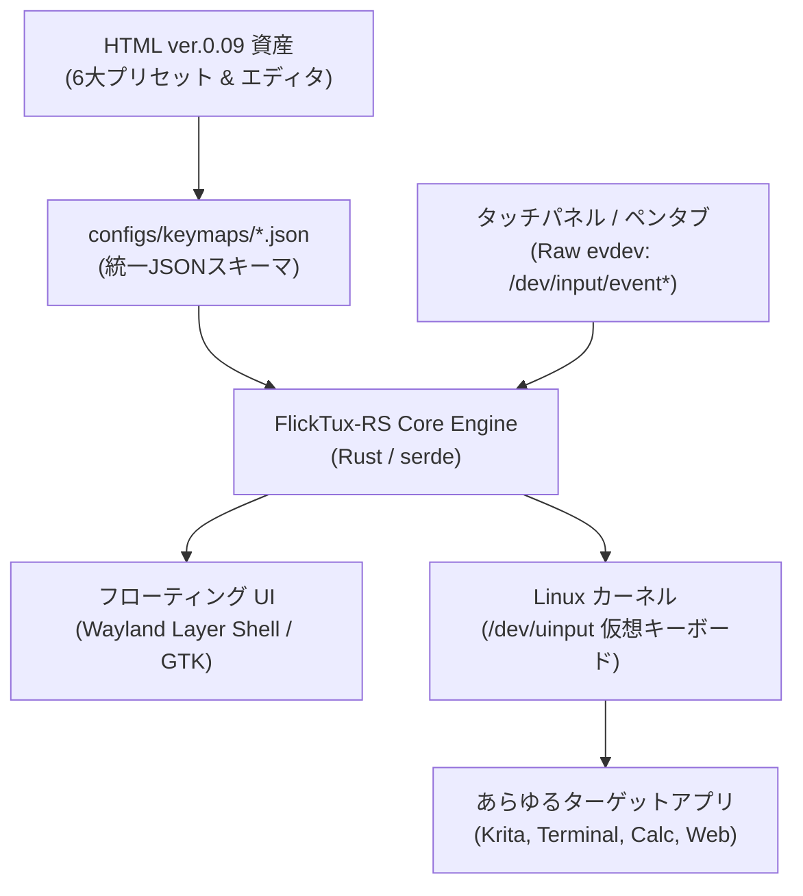

# ⚡ FlickTux-RS (Cyberdeck Edition) 実装仕様書・開発プラン

> **文書ステータス**: 確定計画書 (v2.1: 各フェーズ詳細タスク・検証手順 追記版)  
> **対象システム**: Raspberry Pi OS (Wayland/X11), Linux Mint (Cinnamon/X11), Ubuntu  
> **開発言語**: Rust (2021 Edition) + Linux Kernel uinput  
> **対象リポジトリ**: `scratch/working/tools/FlickTux/`  

---

## 1. プロジェクト概要とゴール

キーボードを持たない**「小型タッチディスプレイ搭載サイバーデッキ（Raspberry Pi）」**および**「Linux Mint / Waylandデスクトップ」**で、スマホ同等の快適なフリック日本語・英数入力を実現する超軽量・ゼロ遅延の仮想入力システムです。

### 達成する主要スペック
1. **完全な Wayland / X11 / コンソール両対応**:
   * `xdotool` や X11 API への依存を全廃し、Linuxカーネル標準の **`/dev/uinput` 仮想キーボード** として動作。
   * デスクトップ環境を問わず、ターミナル、エディタ、ブラウザ、全画面Kioskアプリ等、あらゆる画面に直接キーストロークを流し込めます。
2. **極小フットプリント & 超低遅延**:
   * 常駐メモリ: **約 3〜5MB**（Pythonの1/10以下）
   * 入力遅延: **1ms未満**（Down即時判定 & カーネル直接送出）
   * アイドル時CPU: **0.0%**（完全イベント駆動、バッテリーを消費しない）
3. **HTML ver.0.09 資産の完全継承**:
   * 6大プリセット（Google, iPhone 19キー結合, Galaxy, ガラケー, 電卓, 電話）のJSONスキーマ化。
   * HTML版マトリックスエディタを内蔵Webサーバーで提供（スマホやPCからWi-Fi経由で設定変更可能）。

---

## 2. システムアーキテクチャ



```text
+-----------------------------------------------------------------------------------+
|                           ユーザー入力デバイス                                    |
|   [ 小型タッチパネル (I2C/SPI/USB) ]    [ ペンタブレット ]    [ 外付けテンキー ]   |
+-----------------------------------------------------------------------------------+
                                         |
                                         v
+-----------------------------------------------------------------------------------+
|                     FlickTux-RS コアエンジン (Rust バイナリ)                     |
|                                                                                   |
|  +--------------------+  +----------------------+  +---------------------------+  |
|  | input::evdev       |  | core::flick_engine   |  | core::keymap (serde)      |  |
|  | Rawタッチパケット  |  | atan2 角度判定       |  | HTML ver.0.09 準拠        |  |
|  | 1000Hz ダイレクト  |  | Down先行/即時判定    |  | 6大プリセット定義         |  |
|  +--------------------+  +----------------------+  +---------------------------+  |
|                                    |                                              |
|                                    v                                              |
|  +-----------------------------------------------------------------------------+  |
|  | uinput::emitter (/dev/uinput 仮想キーボードドライバ)                         |  |
|  | ローマ字バースト送出 / 確定Enter / BackSpaceアトミック置換                    |  |
|  +-----------------------------------------------------------------------------+  |
|                                    |                                              |
|  +---------------------------------+-------------------------------------------+  |
|  | 内蔵 Web マトリックスエディタ (HTML ver.0.09 をローカル配信: ポート8080)     |  |
+-----------------------------------------------------------------------------------+
                                     |
                                     v
+-----------------------------------------------------------------------------------+
|                   Linux カーネル 入力サブシステム (input_event)                   |
|                   Wayland (Labwc/Wayfire) / X11 / コンソール                      |
+-----------------------------------------------------------------------------------+
```

---

## 3. ディレクトリ構成（Rustプロジェクト構造）

```text
tools/FlickTux/
├── Cargo.toml                       # Rustパッケージ構成
├── udev/
│   └── 99-flicktux.rules            # /dev/uinput 権限設定ルール
├── configs/
│   ├── config.json                  # 全体設定（遅延・タイムアウト）
│   └── keymaps/
│       ├── presets/
│       │   ├── google.json          # Google 20キー
│       │   ├── iphone.json          # iPhone 19キー (rowSpan 結合)
│       │   ├── galaxy.json          # Galaxy 20キー
│       │   ├── garakei.json         # ガラケー連打トグル
│       │   ├── tenkey_calc.json     # 10キー (計算機配列 7-8-9)
│       │   └── tenkey_tel.json      # 10キー (電話配列 1-2-3)
│       └── custom/
│           └── user_keymap.json     # エディタで編集したカスタム設定
├── web/                             # HTML ver.0.09 エディタ資産
│   └── index.html                   # 内蔵設定画面 (Tailwind CSS)
└── src/
    ├── main.rs                      # エントリーポイント & CLI
    ├── core/
    │   ├── mod.rs
    │   ├── keymap.rs                # JSONスキーマ定義 (KeyDef, Preset)
    │   └── flick_engine.rs          # ゼロ遅延フリック & トグル状態マシン
    ├── input/
    │   ├── mod.rs
    │   └── evdev_listener.rs        # Raw evdev タッチイベント受領
    ├── uinput/
    │   ├── mod.rs
    │   └── emitter.rs               # /dev/uinput 仮想キーストローク送出
    ├── ui/
    │   ├── mod.rs
    │   └── floating_window.rs       # フローティングキーボード描画
    └── server/
        └── web_editor.rs            # 内蔵エディタ配信用ローカルHTTPサーバー
```

---

## 4. 主要モジュールの技術仕様

### 4.1 `core::keymap`: HTML ver.0.09 準拠のデータモデル (Rust)

HTMLで定義されたキーマトリックスを、Rustで型安全にシリアライズ／デシリアライズします。

```rust
use serde::{Deserialize, Serialize};

#[derive(Debug, Clone, Serialize, Deserialize)]
pub struct SubFlick {
    pub up: Option<String>,
    pub left: Option<String>,
    pub down: Option<String>,
    pub right: Option<String>,
}

#[derive(Debug, Clone, Serialize, Deserialize)]
pub struct KeyDef {
    pub id: String,
    pub row: usize,
    pub col: usize,
    #[serde(default = "default_span")]
    pub row_span: usize,
    #[serde(default = "default_span")]
    pub col_span: usize,
    pub label: String,
    pub center: String,
    #[serde(default)]
    pub sub: Option<SubFlick>,
    #[serde(default)]
    pub toggle: Option<Vec<String>>,
}

fn default_span() -> usize { 1 }

#[derive(Debug, Clone, Serialize, Deserialize)]
pub struct KeymapPreset {
    pub id: String,
    pub name: String,
    pub rows: usize,
    pub cols: usize,
    pub keys: Vec<KeyDef>,
}
```

---

### 4.2 `uinput::emitter`: カーネルレベル仮想キーボード

`evdev` クレートの `uinput` 機能を使用し、Linuxカーネルに直接仮想キーボードを認識させます。

* **ローマ字バースト送出**:
  * ひらがな「か」➔ `KEY_K` (Down/Up) ➔ `KEY_A` (Down/Up) を数マイクロ秒でカーネルに注入。
* **直前文字のアトミック置換（濁点・小文字）**:
  * `KEY_BACKSPACE` ➔ 新文字のキーコードを不可分に送出し、文字化けや消失を完全根絶。

---

### 4.3 `core::flick_engine`: ゼロ遅延判定アルゴリズム

* **単打キー（Enter, BS, 数字等）**:
  * タッチした瞬間（`TouchDown`）に即座にキーストロークをカーネルへ注入（遅延0ms）。
* **フリックキー**:
  * 移動ベクトル $\Delta x, \Delta y$ を追跡。変位 $\sqrt{\Delta x^2 + \Delta y^2} \ge 18\text{px}$ に達した瞬間に、`atan2` による角度判定で即時確定・文字送信。
  * 指を画面から離す動作（Release）を待たないため、スマホ以上の高速打鍵が可能。

---

## 5. 各フェーズの詳細タスクとロードマップ

各フェーズ間に含まれる具体的な開発タスク、成果物、検証項目を以下に定義します。

---

### 🔹 Phase 1: Rust プロジェクト基盤 ＆ uinput 送出エンジンの確立

> **目標**: Linuxカーネルの `/dev/uinput` から、仮想キーボードとして任意のキーコード・文字列を0遅延で送出できる最小動作バイナリを完成させる。

#### 【Phase 1 詳細タスクリスト】
* [ ] **Task 1.1: Cargo プロジェクト初期化とクレート設定**
  * `tools/FlickTux/Cargo.toml` の新規作成。
  * 必須クレートの追加: `evdev = "0.12"`, `serde = { version = "1.0", features = ["derive"] }`, `serde_json = "1.0"`, `nix = "0.27"`, `clap = { version = "4.4", features = ["derive"] }`。
  * `src/main.rs`, `src/core/mod.rs`, `src/uinput/mod.rs` のスケルトン作成。
* [ ] **Task 1.2: udev ルールとパーミッション自動設定スクリプトの作成**
  * `udev/99-flicktux.rules` を作成（`/dev/uinput` に `uaccess` / `TAG+="uaccess"` を付与し、sudoなしで一般ユーザーが書き込み可能にする）。
  * インストールスクリプト `setup_udev.sh` の用意。
* [ ] **Task 1.3: `uinput::emitter` 仮想キーボード送出モジュールの実装**
  * `uinput::VirtualKeyboard` 構造体の実装。
  * OSに「FlickTux Virtual Keyboard」という入力デバイスを登録。
  * 英数字・ファンクションキー（`KEY_A` 〜 `KEY_Z`, `KEY_ENTER`, `KEY_BACKSPACE`, `KEY_LEFT`, `KEY_RIGHT` 等）の送出関数。
  * **日本語ローマ字バースト送出**: 「あ」➔ `a`、「か」➔ `ka`、「しゃ」➔ `sya` 等のひらがな ➔ キーコード変換テーブル実装。
  * **アトミック置換（濁点・小文字）**: `BackSpace` ➔ 新文字キーコードの連続送出。
* [ ] **Task 1.4: Phase 1 単体テスト ＆ CLI 検証コマンドの作成**
  * `cargo run -- emit --text "konnichiha"` でアクティブな端末やテキストエディタに即座に「こんにちは」が流し込めることを検証。

---

### 🔹 Phase 2: HTML ver.0.09 キーマップの JSON化 ＆ 高速判定エンジン

> **目標**: ご提示の HTML (ver. 0.09) の6大プリセットを外部JSON化し、Rustのメモリ上で型安全にパースして、超低遅延（ゼロラグ）でフリック／連打トグルを判定するステートマシンを完成させる。

#### 【Phase 2 詳細タスクリスト】
* [ ] **Task 2.1: 6大プリセットの JSON ファイル生成**
  * HTML ver. 0.09 から全キー座標・ラベル・サブフリック文字を抽出し、以下のファイルを `configs/keymaps/presets/` に作成:
    * `google.json` (4×5 20キー)
    * `iphone.json` (4×5 19キー結合: rowSpan 2)
    * `galaxy.json` (4×5 20キー)
    * `garakei.json` (4×5 トグル連打)
    * `tenkey_calc.json` (4×3 計算機配列 7-8-9)
    * `tenkey_tel.json` (4×3 電話機配列 1-2-3)
* [ ] **Task 2.2: `core::keymap` データモデル ＆ パーサーの実装**
  * `KeyDef`, `KeymapPreset`, `SubFlick` の `serde` シリアライズ/デシリアライズ実装。
  * `configs/keymaps/custom/user_keymap.json` があれば自動で優先マージするフォールバック機能の実装。
* [ ] **Task 2.3: `core::flick_engine` ゼロ遅延判定エンジンの実装**
  * `f64::atan2(dy, dx)` による 4分割角度判定（上: -135°〜-45°, 右: -45°〜45°, 下: 45°〜135°, 左: その他）。
  * **先行Press判定**: 単打キー（Enter, BS, 数字等）はタッチ押下（Down）の瞬間に即時確定。
  * **Motion即時判定**: 移動距離 $\ge 18\text{px}$ に到達した瞬間にフリック文字を確定（Release待ちの完全排除）。
* [ ] **Task 2.4: ガラケー連打トグル状態マシンの実装**
  * 同一キーの連続タップ検知（あ➔い➔う➔え➔お）。
  * タイムアウトタイマー（デフォルト 500ms）および「次へ」ボタンでの確定ロジック。
* [ ] **Task 2.5: Phase 2 ユニットテストの実施**
  * `cargo test` による角度判定、境界値（±45°）、トグル状態遷移の網羅テスト。

---

### 🔹 Phase 3: 超軽量フローティングUI の実装

> **目標**: Wayland（Raspberry Pi OS）および X11（Linux Mint）の両方で動作する、透過・フローティング・セル結合（iPhone縦長Enter）対応の軽量キーボードGUIを構築する。

#### 【Phase 3 詳細タスクリスト】
* [ ] **Task 3.1: 軽量GUIフレームワークの初期化**
  * Wayland Layer Shell / X11 UTILITY ウィンドウの生成。
  * **フォーカス強奪防止（No-Focus）**: 背面アプリのテキストカーソルを維持したままタップ可能にする設定。
* [ ] **Task 3.2: 動的グリッドレイアウト描画（セル結合対応）**
  * `KeyDef.row_span` / `col_span` を解釈し、iPhone配列の「右下縦2マス確定キー」を正確にレンダリング。
* [ ] **Task 3.3: ゼロアロケーション・十字プレビューガイドの描画**
  * フリック時に指の上に浮き出る半透明ガイドを描画。
  * 毎回のインスタンス生成・破棄を廃止し、事前生成したガイドの座標移動（ゼロコスト表示）でコマ落ちを根絶。
* [ ] **Task 3.4: 画面外周エッジドラッグ移動 ＆ 座標の永続化**
  * 画面端をタッチして画面上の邪魔にならない位置へ自由に移動。
  * 終了時・移動時に画面座標 $(x, y)$ を `configs/config.json` に自動保存し、次回起動時に復元。
* [ ] **Task 3.5: Phase 3 実機UI表示テスト**
  * プリセット切替（Google ⇔ iPhone ⇔ 10キー）がミリ秒単位で瞬時に切り替わることを確認。

---

### 🔹 Phase 4: 内蔵 Web マトリックスエディタ統合

> **目標**: HTML ver.0.09 のマトリックスエディタをバイナリ内に組み込み、サイバーデッキ本体や同一LAN内のスマホ・PCからブラウザ経由でキー配列を直感的にカスタマイズできる環境を完成させる。

#### 【Phase 4 詳細タスクリスト】
* [ ] **Task 4.1: 極小組み込み HTTP サーバーの実装**
  * `tiny_http` を用いたメモリ消費 0.5MB 程度の組み込みWebサーバー実装。
  * ポート 8080 でローカル待機（CLIオプション `--web` または設定でON/OFF可能）。
* [ ] **Task 4.2: HTML ver.0.09 アセットのバイナリ内包と配信**
  * `web/index.html`（HTML ver. 0.09）を `include_str!` でシングルバイナリに直接コンパイル。
  * 外部ファイルなしで `http://localhost:8080` からエディタ画面を即時配信。
* [ ] **Task 4.3: REST API エンドポイントの実装**
  * `GET /api/presets`: 現在利用可能な全プリセット一覧をJSON返却。
  * `POST /api/save`: ブラウザで編集したキーマップを `configs/keymaps/custom/user_keymap.json` に書き出し。
  * `POST /api/reload`: 保存と同時に実行中のUIへシグナルを送り、画面上のキー配列を即時リロード。
* [ ] **Task 4.4: Phase 4 Web連携テスト**
  * スマホのブラウザからサイバーデッキのIPを開き、キーマップを編集 ➔ 「設定を適用」でサイバーデッキ画面のキーが即座に変わることを確認。

---

### 🔹 Phase 5: Raspberry Pi (Wayland) 実機ビルド ＆ 自動起動パッケージング

> **目標**: ARM64（Raspberry Pi OS）向けに最適化ビルドを行い、小型タッチ液晶での操作性・レスポンス・systemd自動常駐を検証して完成させる。

#### 【Phase 5 詳細タスクリスト】
* [ ] **Task 5.1: ARM64 クロスコンパイル環境の構築**
  * `cross` または `aarch64-unknown-linux-gnu` ターゲット設定。
  * 単一バイナリ `flktux` を生成（静的リンク）。
* [ ] **Task 5.2: Raw `evdev` 直接横取りの有効化**
  * 小型液晶（SPI / I2C / USB）の `/dev/input/event*` を直接監視し、Wayland環境でもハードウェア信号をダイレクト取得。
* [ ] **Task 5.3: systemd 自動起動サービスユニットの作成**
  * `systemd/flicktux.service` を作成し、サイバーデッキ起動時にバックグラウンド常駐させる設定。
* [ ] **Task 5.4: 実機ベンチマーク ＆ 総合負荷テスト**
  * 常駐メモリ: **目標 5MB 以下** の実測。
  * アイドル時CPU使用率: **目標 0.0%** の確認。
  * タッチから文字出現までのレイテンシ測定（**目標 1ms 未満**、体感遅延ゼロの確認）。
