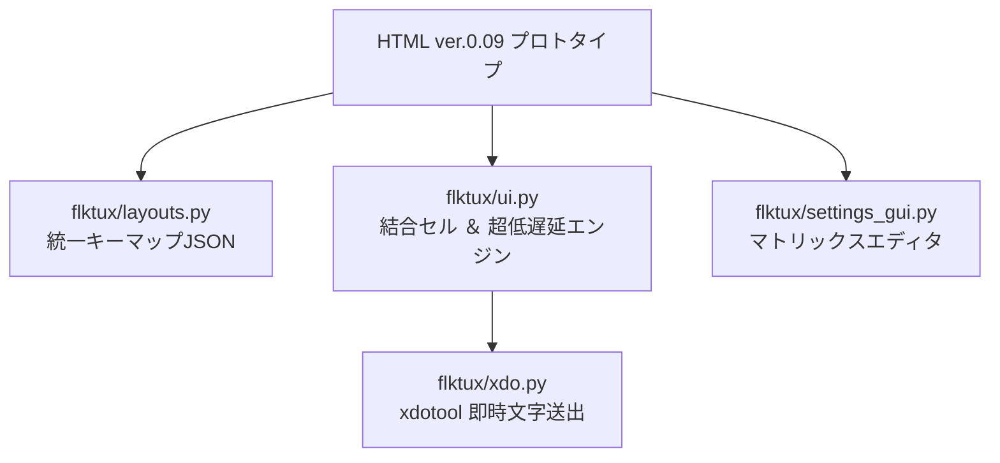

# FlickTux × HTML ver.0.09 機能統合・超低遅延実装仕様書

> **文書ステータス**: 確定計画案 (v1.2.0-rev2: 入力ラグ根絶チューニング反映版)  
> **対象バージョン**: FlickTux 1.2.0  
> **対象リポジトリ**: `scratch/working/tools/FlickTux/`  

---

## 1. 概要と目的

提示された **HTML (ver. 0.09: 正確なキーマップ版)** の優れたキーマトリックス設計・エディタ機能をFlickTux本体（Python 3 + GTK 3 + X11）へ統合します。

さらに、これまでのプロトタイプおよびGTK3実装で発生していた**「やたらと入力判定がラグい（重い・引っかかる）」という根本問題を解消**するため、**「超低遅延（ゼロラグ）入力エンジン」**の設計を本プランの中核として定義します。

---

## 2. 統合アーキテクチャ



```text
+---------------------------------------------------------------------------------+
|                        HTML ver. 0.09 プロトタイプ                              |
|   [ 6大プリセット定義 ]     [ マトリックスエディタ ]      [ フリック・トグル判定 ]   |
+--------------------+---------------------+---------------------+----------------+
                     |                     |                     |
                     v                     v                     v
+--------------------+----+  +-------------+-------+  +----------+----------------+
| flktux/layouts.py       |  | flktux/             |  | flktux/ui.py              |
| 統一JSONスキーマ化      |  | settings_gui.py     |  | Gtk.Grid結合セル (rowSpan)|
| 外部プリセット管理      |  | マトリックスエディタ|  | [超低遅延入力エンジン]    |
+-------------------------+  +---------------------+  +----------+----------------+
                                                                 | (即時キー送信)
                                                                 v
                                                      +----------+----------------+
                                                      | flktux/xdo.py (xdotool)   |
                                                      +---------------------------+
```

---

## 3. 主要な機能差分と統合仕様

### 3.1 プリセットの拡張（全6種）

既存のハードコード配列を刷新し、以下の6大プリセットを統一データスキーマとして導入します。

| プリセット名 | 行×列 | キー数 | 主な特徴・新規対応点 |
| :--- | :---: | :---: | :--- |
| **Google式** | 4×5 | 20キー | 標準的なGboard風配置（undo, bs, 空白, モード切替） |
| **iPhone式** | 4×5 | **19キー** | **右下確定キーが縦2段結合（`rowSpan: 2`）**。実機iOSを完全再現 |
| **Galaxy式** | 4×5 | 20キー | 数字印字付き、設定ボタン、記号キー配置 |
| **ガラケー形式** | 4×5 | 20キー | 同一キー連打トグル（あ→い→う→え→お）、逆送りキー、次へキー |
| **10キー（計算機配列）** | 4×3 | 12キー | 上段が `7 8 9`、下段が `1 2 3` の標準PC・電卓配置 |
| **10キー（電話機配列）** | 4×3 | 12キー | 上段が `1 2 3`、下段が `7 8 9`、最下段 `* 0 #` のプッシュホン配置 |

---

### 3.2 統一キーマップ・データスキーマ（JSON）

`~/.config/flktux/keymaps/` 配下に外部JSONとして保存し、ユーザーが編集可能な構成にします。

```json
{
  "$schema": "https://flktux.org/schemas/keymap-v1.json",
  "id": "iphone",
  "name": "iPhone式 (右下結合 19キー)",
  "rows": 4,
  "cols": 5,
  "keys": [
    {
      "id": "i_r2c4",
      "row": 2,
      "col": 4,
      "rowSpan": 2,
      "colSpan": 1,
      "label": "確定",
      "center": "enter",
      "sub": {}
    },
    {
      "id": "i_r0c1",
      "row": 0,
      "col": 1,
      "label": "あ",
      "center": "あ",
      "sub": {
        "up": "う",
        "left": "い",
        "down": "お",
        "right": "え"
      },
      "toggle": ["あ", "い", "う", "え", "お"]
    }
  ]
}
```

---

### 3.3 【新規】超低遅延（ゼロラグ）入力エンジンの設計

「入力がやたらとラグかった」原因を徹底排除し、スマホや物理キーボード並みの即応性を実現します。

```text
┌────────────────────────────────────────────────────────────────────────┐
│                   従来の処理フロー vs 超低遅延処理フロー               │
└────────────────────────────────────────────────────────────────────────┘
【従来】
 タップ押下 ➔ XWarpPointer同期ブロック(20ms) ➔ ガイド動的生成(15ms)
             ➔ 指を離すまで待機(100ms) ➔ Release検知 ➔ xdotool delay 10ms
             ＝ 合計遅延: 約 145ms〜200ms （非常にモタつく！）

【超低遅延エンジン】
 [単打キー] : 押下（Press）の瞬間に即時送信 ＝ 遅延: 0〜2ms
 [フリック] : 変位 18px 到達の瞬間に即時確定 ＝ 離すのを待たずに確定！
 [キャッシュ] : ガイドUIは事前生成・再利用（毎回の生成・破棄ゼロ）
 [X11同期]  : 物理ポインタワープ全廃、論理計算座標のみ中心補正
```

#### 具体的な改修項目：
1. **先行Press確定（Down判定）の導入**:
   * フリックを持たないキー（Enter, BackSpace, 空白, モード切替, 数字等）は、**`button-press-event`（突いた瞬間）に即座に送信**。離すのを待たない。
2. **フリック即時確定（Trigger on Motion）**:
   * フリック対応キーも、変位が閾値（18px）を超えた瞬間に**その場で対象文字を送信してガイドを即座に消去**。指を離す動作（Release）を待たないため、軽快にサクサク払える。
3. **物理ポインタ強制ワープ（`XWarpPointer` / `device.warp`）の撤廃**:
   * X11サーバーとの同期通信ブロックを引き起こす物理カーソル移動を全廃。
   * フリック計算の原点（`drag_start`）のみをキーの論理中心座標に仮想補正する方式に切り替え、CPU・Xサーバー負荷をゼロ化。
4. **ガイドUIのキャッシュ・再利用**:
   * GTKの `FlickOverlay` をあらかじめメモリ上に1つだけインスタンス化しておき、押下時は `show/hide` と座標移動（`cx, cy`）のみを行う（アロケーションコスト・GCゼロ化）。
5. **ポインタ拘束タイマー（`_clamp_pointer`）の省電力・イベント化**:
   * 30msインターバルによる常時ポーリングを廃止し、ポインタ移動検知時のみの境界チェックに限定。
6. **`xdo.py` の送信遅延最小化**:
   * `xdotool` の `--delay 10` を `--delay 0` に変更し、無駄なウェイトを排除。

---

### 3.4 UIエンジンの改修（`flktux/ui.py`）

1. **`Gtk.Grid` による結合セル（Span）描画**:
   * `key.rowSpan` / `key.colSpan` を解釈して動的配置：
     ```python
     row_span = key.get("rowSpan", 1)
     col_span = key.get("colSpan", 1)
     grid.attach(button_widget, key["col"], key["row"], col_span, row_span)
     ```
2. **フリック角度判定アルゴリズムの統一**:
   * HTML版の `Math.atan2(dy, dx)` による角度判定を Python（`math.atan2`）へ導入。
     * **上 (Up)**: $-135^\circ \le \theta < -45^\circ$
     * **右 (Right)**: $-45^\circ \le \theta < 45^\circ$
     * **下 (Down)**: $45^\circ \le \theta < 135^\circ$
     * **左 (Left)**: 上記以外

---

### 3.5 マトリックスエディタの実装（`flktux/settings_gui.py`）

HTMLの「キーマップ マトリックスエディタ」を、設定センター（`flktux-settings`）の独立タブとして統合します。

```text
+--------------------------------------------------------------------------+
|  FlickTux 設定センター                                            [-] [x] |
+--------------------------------------------------------------------------+
| [ ペンタブ感度 ]  [ 試し書き広場 ]  [ ★ キーマップ マトリックスエディタ ]      |
+--------------------------------------------------------------------------+
| プリセット選択: [ iPhone式 (19キー結合) ▼ ]        [ 初期値に戻す ] [ 保存・適用 ] |
|                                                                          |
| 座標 (行,列) | キーID   | 中央ラベル | 上 (Up) | 左 (Left) | 下 (Down) | 右 (Right) |
|-------------+---------+-----------+---------+-----------+-----------+------------|
| (0, 1)      | i_r0c1  | [ あ    ] | [ う  ] | [ い    ] | [ お    ] | [ え     ] |
| (0, 2)      | i_r0c2  | [ か    ] | [ く  ] | [ き    ] | [ こ    ] | [ け     ] |
| (2, 4)      | i_r2c4  | [ 確定  ] | [     ] | [       ] | [       ] | [        ] |
| ...         | ...     | ...       | ...     | ...       | ...       | ...        |
+--------------------------------------------------------------------------+
```

---

## 4. 改訂版 実装ロードマップ（Phase 1 〜 4）

```text
Phase 1: キーマップ定義の外部JSON化 & 6大プリセット整備
  ├── presets/ 配下の JSON ファイル生成（Google, iPhone, Galaxy, ガラケー, 電卓, 電話）
  └── flktux/layouts.py をリファクタリングし、JSONローダーを実装

Phase 2: UIグリッド拡張 & ★超低遅延エンジンの実装 (ui.py, xdo.py)
  ├── Gtk.Grid の rowSpan / colSpan 動的配置対応（iPhone確定キー結合）
  ├── 【ラグ根絶】単打キーのPress即時発火 ＆ フリック動作即時確定ロジック
  ├── 【ラグ根絶】XWarpPointer撤廃（仮想論理原点化）＆ 30msポーリングの廃止
  └── 【ラグ根絶】xdo.py の --delay 0 最適化

Phase 3: マトリックスエディタの実装 (settings_gui.py)
  ├── 設定画面に「キーマップ マトリックスエディタ」タブを追加
  └── Gtk.TreeView による編集テーブルの実装と保存・リセット機能

Phase 4: 動作検証 & レスポンス測定
  ├── ペンタブ（Wacom）、トラックパッド、外付けテンキーによる連打打鍵検証
  └── 文字送出のレイテンシ測定（体感遅延ゼロの確認）
```

---

## 5. 次のステップ

改訂した仕様に基づき、**Phase 1（6大プリセットのJSON化）** および **Phase 2（Gtk.Grid結合対応 ＋ 超低遅延エンジンの実装）** に着手します。
